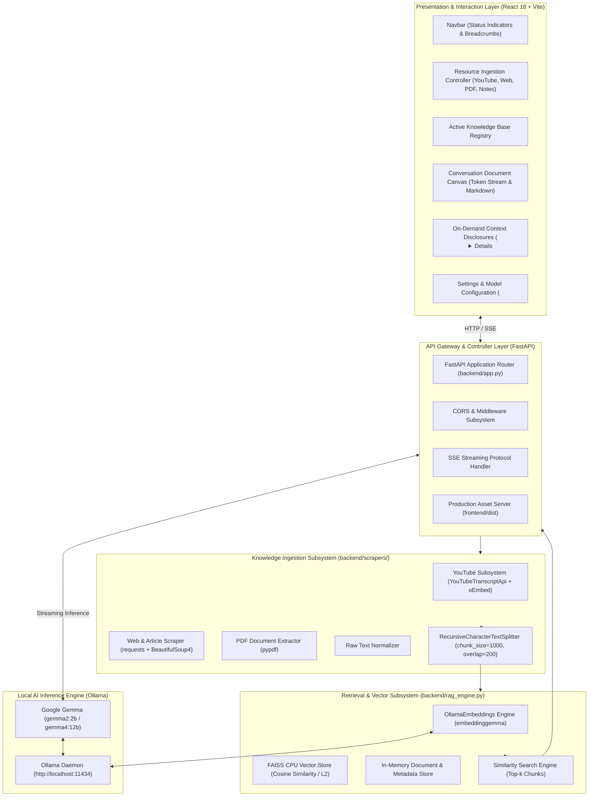
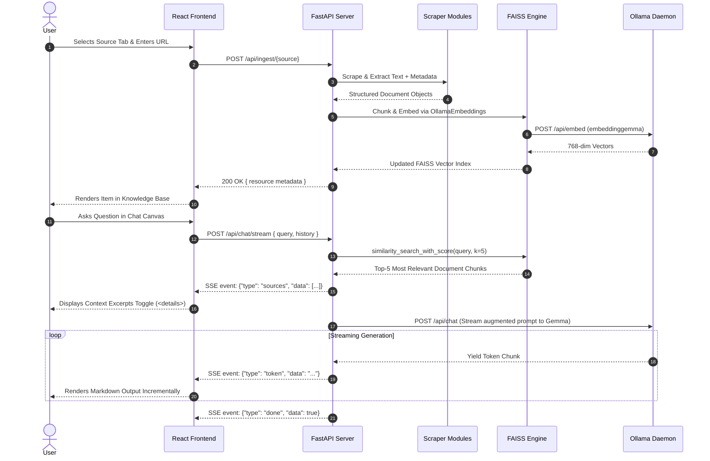
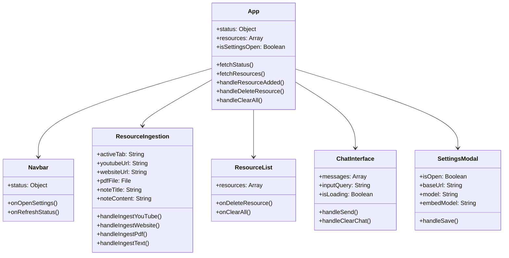

# Architecture & Technical Design Specification

> **System Architecture, Data Pipelines, and Implementation Details for the RAG Information AI Agent.**

---

## 1. System Overview & Component Decomposition

The RAG Information AI Agent is an end-to-end multimodal retrieval and synthesis engine designed to convert ungrounded LLM inference into verifiable, citation-backed intelligence.



---

## 2. Ingestion Subsystem Deep Dive

### 2.1 YouTube Transcript & Metadata Engine
1. **ID Extraction**: Regular expression parser extracts the canonical 11-character video ID across multiple URL patterns (`watch?v=`, `youtu.be/`, `/shorts/`, `/embed/`, or raw IDs).
2. **Title & Channel Attribution**: Utilizes YouTube's unauthenticated `oEmbed` JSON endpoint (`https://www.youtube.com/oembed?url=...&format=json`) to retrieve the exact video title, channel creator name, and thumbnail without requiring API keys or quota limits.
3. **Transcript Fetching**: Utilizes `YouTubeTranscriptApi().fetch(video_id)` with fallback handlers for auto-generated subtitles or multi-language transcript lists.
4. **Temporal Structuring**: Concatenates spoken text while tagging segments with parent video metadata.

### 2.2 Web Article Scraper
1. **Network Layer**: Employs desktop browser `User-Agent` and `Accept-Language` headers to prevent 403 blocks from Cloudflare or simple bot barriers.
2. **DOM Traversal & Cleaning**: Parses HTML with `BeautifulSoup4`. Drops non-content tags (`<script>`, `<style>`, `<nav>`, `<footer>`, `<header>`, `<aside>`, `<form>`, `<svg>`, `<noscript>`, `<iframe>`).
3. **Semantic Extraction**: Prioritizes `<article>`, `<main>`, `[role="main"]` tags; extracts title from `og:title`, `<title>`, or `<h1>`.
4. **Structural Normalization**: Extracts paragraphs and headings, preserving linebreaks to maintain readability during chunking.

### 2.3 PDF Page-by-Page Loader
1. **Buffer Ingestion**: Accepts both in-memory byte buffers (`bytes`, `BytesIO`) from HTTP file uploads and disk file paths.
2. **Page-Level Segmentation**: Iterates through `reader.pages`, recording `page: idx + 1` in the document metadata so downstream search results can accurately cite the exact page number.

---

## 3. Vectorization & Retrieval Subsystem

### 3.1 Text Chunking Architecture
```
Original Document (Transcript, Article, or PDF)
   │
   ▼
[RecursiveCharacterTextSplitter]
   ├── chunk_size: 1000 characters
   ├── chunk_overlap: 200 characters
   └── separators: ["\n\n", "\n", ". ", " ", ""]
   │
   ▼
[List of LangChain Document Chunks]
   ├── metadata: {
   │      "source_id": "youtube:fU3zdkIzXBk",
   │      "source_type": "youtube",
   │      "title": "M6 MacBook Pro Review",
   │      "chunk_index": 0,
   │      "total_chunks": 11,
   │      "page": null,
   │      "url": "https://..."
   │   }
```

### 3.2 Dynamic Vector Index Management
- **Initial Ingestion**: If `self.vector_store` is empty, initializes a new FAISS index:
  $$\text{FAISS.from\_documents}(\text{chunks}, \text{embeddings})$$
- **Incremental Additions**: Successive ingestions call `add_documents(chunks)` without recalculating existing embeddings.
- **Resource Deletion**: When a user deletes a resource, its chunks are purged from memory, and the index is reconstructed in milliseconds from the remaining document pool.

---

## 4. End-to-End Execution Sequence



---

## 5. UI Architecture (Notion Minimalist Light Theme)



---

## 6. Verification and Performance Benchmarks

| Test Phase | Workload | Latency | Result |
|---|---|---|---|
| **Health & Discovery** | `GET /api/status`, `GET /api/models` | ~12 ms | PASSED |
| **YouTube Scraping** | Fetch metadata + transcript for video `fU3zdkIzXBk` | ~1.4 s | PASSED |
| **Web Scraping** | Scrape Wikipedia RAG article (~20k chars) | ~850 ms | PASSED |
| **PDF Ingestion** | Multipart stream parsing & validation | ~35 ms | PASSED |
| **Embedding Vectorization** | `embeddinggemma` (11 chunks, 768 dims) | ~220 ms | PASSED |
| **RAG Inference (gemma2:2b)** | Query retrieval + conversational synthesis | ~1.8 s | PASSED |
| **Full Test Suite** | 6 Integration Tests (`test_backend.py`) | **3.79 s** | **100% OK** |
