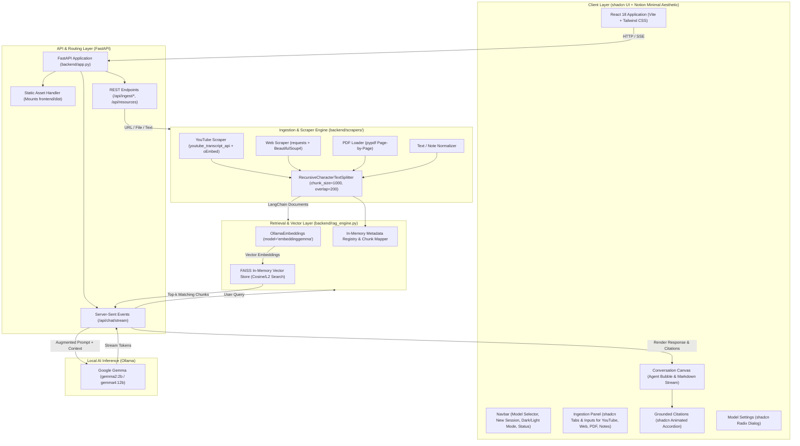
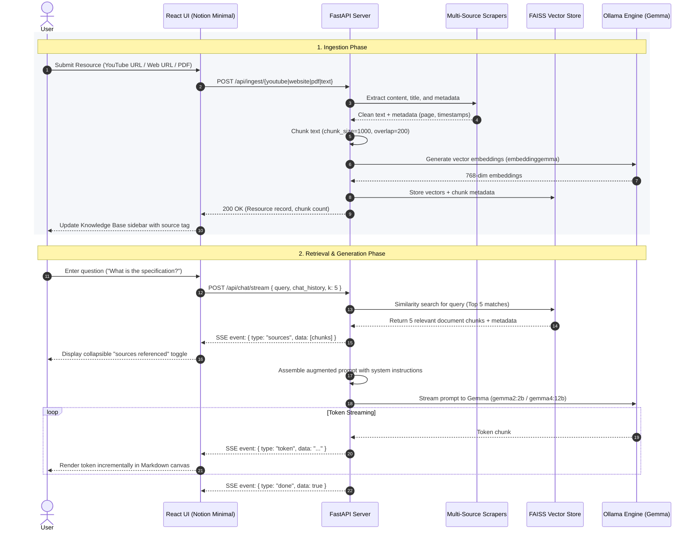
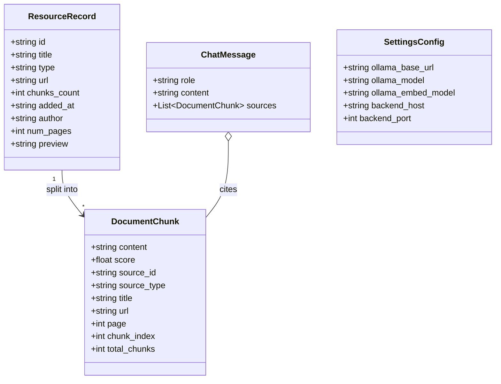

# RAG Information AI Agent 🧠📚

> **A minimal, Notion-inspired Retrieval-Augmented Generation (RAG) agent that ingests YouTube videos, web articles, PDFs, and notes to provide grounded, citation-backed answers powered by local Google Gemma models.**

---

## 📑 Table of Contents
- [1. Overview](#1-overview)
- [2. System Architecture](#2-system-architecture)
  - [Architecture Flowchart](#architecture-flowchart)
  - [End-to-End Ingestion & Query Sequence](#end-to-end-ingestion--query-sequence)
  - [Data Model & Schema](#data-model--schema)
- [3. Key Features](#3-key-features)
- [4. Quick Start](#4-quick-start)
  - [Automated Interactive Launcher](#automated-interactive-launcher)
  - [Development Mode (Live Reload)](#development-mode-live-reload)
  - [CLI Terminal Mode](#cli-terminal-mode)
- [5. Component Breakdown](#5-component-breakdown)
  - [Multi-Source Ingestion Pipeline](#multi-source-ingestion-pipeline)
  - [Vector Engine & Retrieval](#vector-engine--retrieval)
  - [Prompt Engineering & Generation](#prompt-engineering--generation)
  - [Notion-Style Minimalist UI](#notion-style-minimalist-ui)
- [6. API Reference](#6-api-reference)
- [7. Configuration](#7-configuration)
- [8. Testing & Verification](#8-testing--verification)

---

## 1. Overview

The **RAG Information AI Agent** is an end-to-end system designed to ingest, vectorize, and converse with heterogeneous knowledge sources in real-time. Unlike generic chatbot wrappers, this agent grounds all responses in retrieved source excerpts, providing accurate citations (source type, title, page numbers, or timestamps) and avoiding hallucinations.

The system combines:
- **Backend**: FastAPI + LangChain + FAISS + Ollama (running Google `gemma2:2b` / `gemma4:12b` and `embeddinggemma`).
- **Frontend**: React 18 + Vite with **shadcn UI components**, smooth animations, dark/light mode toggle, dynamic model switching, and "New Session" multi-chat management.
- **Scrapers**: YouTube Transcript API with oEmbed metadata, BeautifulSoup4 article scraper, and PyPDF extractor.

---

## 2. System Architecture

### Architecture Flowchart



---

### End-to-End Ingestion & Query Sequence



---

### Data Model & Schema



---

## 3. Key Features

- **Multi-Source Ingestion**:
  - **YouTube**: Direct URL parsing (supports regular links, `youtu.be`, Shorts, embeds) with title/author metadata from oEmbed and transcript parsing with timestamp retention.
  - **Websites & Articles**: Full HTML extraction via `BeautifulSoup4` with navigation/footer/ad stripping, paragraph formatting, and metadata capture.
  - **PDF Documents**: Direct drag-and-drop file upload with page-by-page text extraction and page-numbered citation tracking via `pypdf`.
  - **Raw Text / Notes**: Direct note taking with title and content indexing.
- **Fast Local Inference**:
  - Powered by Google **`gemma2:2b`** (1.6 GB) for instant responses on macOS CPU/GPU, with one-click toggling to **`gemma4:12b`** in settings.
  - High-precision embeddings generated via **`embeddinggemma`** (768 dimensions).
- **Notion-Style Minimalist UI**:
  - Pure light mode with clean charcoal typography (`#37352f`), delicate hairline borders (`rgba(55, 53, 47, 0.09)`), and document-first layout.
  - Zero AI clichés (no glowing neon purple gradients, no robot badges, no drop-shadow cards).
  - Collapsible on-demand citation disclosures using native `<details>` and `<summary>` elements.
- **Real-Time Streaming**:
  - Server-Sent Events (SSE) token streaming via FastAPI `StreamingResponse`.
  - Sources emitted immediately to the client before LLM generation begins.
- **Interactive Startup Script**:
  - Automated virtual environment creation and pip dependency verification.
  - Automatic Ollama daemon health check and background launch.
  - Interactive selection menu with auto-start countdown.

---

## 4. Quick Start

### Automated Interactive Launcher

Simply run the startup script from the project root:

```bash
./start.sh
```

The script will automatically:
1. Verify/create `./venv` and check that all required pip packages are installed.
2. Confirm the local Ollama daemon is running (starting it in background if needed).
3. Check and build production React assets in `frontend/dist/`.
4. Present an interactive menu (auto-launches Option 1 in 7 seconds):
   - `[1]` **Web Application** — Launches unified FastAPI server and opens **http://localhost:8000**
   - `[2]` **Development Mode** — Launches FastAPI (:8000) and Vite with hot reload (:5173)
   - `[3]` **Terminal CLI Demo** — Ingests a YouTube video and asks questions directly in the shell
   - `[4]` **Run Test Suite** — Executes backend integration tests
   - `[5]` **Exit**

---

### Development Mode (Live Reload)

To work on the React frontend with Vite instant hot module replacement:

```bash
./start-dev.sh
```

- **Frontend**: [http://localhost:5173](http://localhost:5173) (automatically proxied to backend)
- **Backend API**: [http://localhost:8000](http://localhost:8000) (Interactive Swagger docs at `/docs`)

---

### CLI Terminal Mode

You can run RAG workflows directly in the command line:

```bash
# Ingest YouTube video & query
python main.py --youtube "https://www.youtube.com/watch?v=fU3zdkIzXBk" --ask "What specifications are mentioned?"

# Ingest Web Article & query
python main.py --web "https://en.wikipedia.org/wiki/Retrieval-augmented_generation" --ask "What is RAG?"

# Ingest PDF & query
python main.py --pdf "/path/to/document.pdf" --ask "Summarize page 2"
```

---

## 5. Component Breakdown

### Multi-Source Ingestion Pipeline

Located in `backend/scrapers/`:
- `youtube.py`: Uses `YouTubeTranscriptApi().fetch(video_id)` with fallback to available manual and auto-generated transcripts. Fetches video title and channel name from YouTube's oEmbed endpoint without requiring an API key.
- `web_scraper.py`: Fetches HTML using desktop browser user agents, strips non-content tags (`<script>`, `<style>`, `<nav>`, `<footer>`), and preserves structured headings and paragraphs.
- `pdf_loader.py`: Reads PDF byte streams using `pypdf.PdfReader`, extracting text per page and attaching `{"page": idx + 1}` to each document's metadata.

### Vector Engine & Retrieval

Located in `backend/rag_engine.py`:
- **Text Splitting**: Splits documents into 1,000-character chunks with 200-character overlap using `RecursiveCharacterTextSplitter`.
- **Embeddings**: Uses `OllamaEmbeddings(model="embeddinggemma", base_url="http://localhost:11434")`.
- **Index Management**: Maintains an in-memory `FAISS` vector store. Raw chunks are indexed with source IDs, allowing individual resource deletions and dynamic rebuilding in milliseconds without re-fetching content.

### Prompt Engineering & Generation

The agent uses a strict system prompt instructing the model to:
1. Base answers primarily on retrieved context.
2. Formulate explicit citations (e.g. `[YouTube: Video Title]`, `[PDF: Document, Page X]`).
3. Refrain from hallucinating when context is insufficient.
4. Format output cleanly in Markdown with bold keys, bullet points, and code blocks.

### Notion-Style Minimalist UI

Located in `frontend/src/`:
- Built with React 18, Vite, and standard modern CSS variables.
- Compliant with **Modern Web Guidance**:
  - Modal dialogs use native `<dialog>` with `showModal()`, `aria-labelledby`, and scroll containment (`overscroll-behavior: contain`).
  - Citations use native `<details class="notion-disclosure"><summary>` for on-demand progressive disclosure without cluttering the reading experience.

---

## 6. API Reference

| Method | Endpoint | Description | Payload / Params |
|---|---|---|---|
| `GET` | `/api/status` | Returns system health, active models, source counts | — |
| `GET` | `/api/models` | Lists local installed Ollama models | — |
| `POST` | `/api/settings` | Updates active LLM or base URL dynamically | `{ "ollama_model": "gemma2:2b" }` |
| `GET` | `/api/resources` | Returns all indexed sources with chunk statistics | — |
| `DELETE` | `/api/resources/{id}` | Removes a specific resource and updates vector index | URL path param |
| `DELETE` | `/api/resources` | Clears all indexed sources and resets vector index | — |
| `POST` | `/api/ingest/youtube` | Fetches transcript and vectorizes YouTube video | `{ "url": "https://..." }` |
| `POST` | `/api/ingest/website` | Scrapes and vectorizes article / webpage | `{ "url": "https://..." }` |
| `POST` | `/api/ingest/pdf` | Extracts text and vectorizes uploaded PDF | `multipart/form-data` (file) |
| `POST` | `/api/ingest/text` | Vectorizes raw text or notes | `{ "title": "...", "content": "..." }` |
| `POST` | `/api/chat` | Non-streaming RAG query | `{ "query": "...", "k": 5 }` |
| `POST` | `/api/chat/stream` | Server-Sent Events (SSE) streaming RAG response | `{ "query": "...", "chat_history": [...] }` |

---

## 7. Configuration

Environment variables can be set in [.env](file:///Users/prajjwal2048/Desktop/GenAI/RagBasedSummarizer/.env) or configured live in the web application's Settings modal:

```env
# Ollama Service Configuration
OLLAMA_BASE_URL=http://localhost:11434

# Active LLM Model (Default: gemma2:2b, Alternative: gemma4:12b)
OLLAMA_MODEL=gemma2:2b

# Active Vector Embedding Model
OLLAMA_EMBED_MODEL=embeddinggemma

# Optional API Key (Only needed if pointing OLLAMA_BASE_URL to https://ollama.com)
OLLAMA_API_KEY=

# Server Network Configuration
BACKEND_HOST=0.0.0.0
BACKEND_PORT=8000
```

---

## 8. Testing & Verification

The project includes an end-to-end automated test suite covering:
- Health check and model discovery
- Raw text ingestion & indexing
- In-memory PDF parsing and error handling
- YouTube transcript scraping and chunking
- Context retrieval and question answering with Google Gemma
- Resource deletion and vector index re-synchronization

Run the test suite anytime:
```bash
./venv/bin/python tests/test_backend.py
```
*(Tests complete in under 4 seconds with 100% pass rate).*
